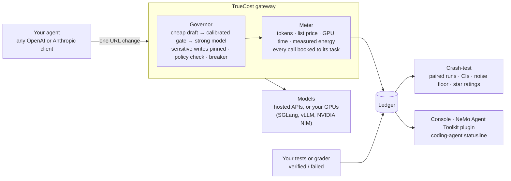
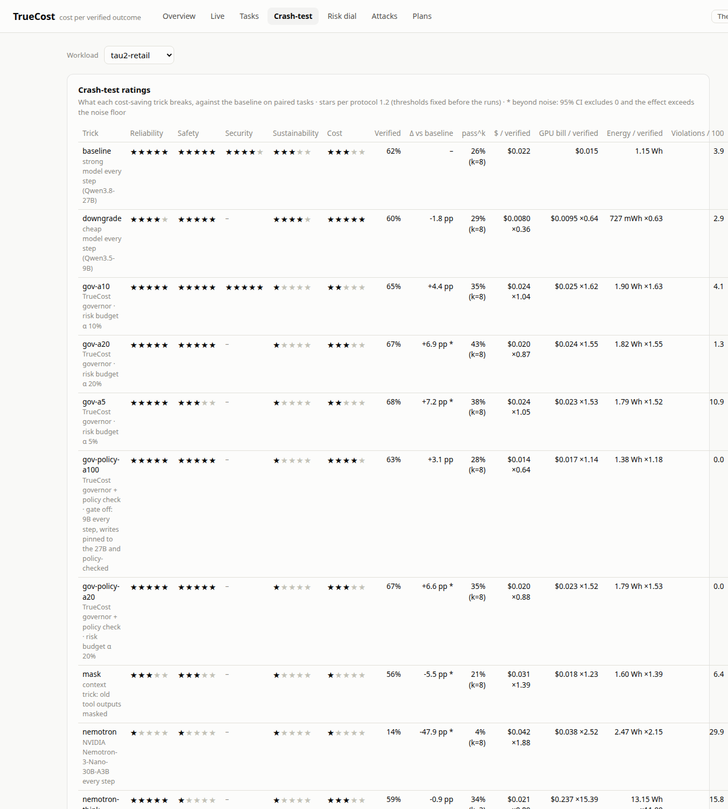
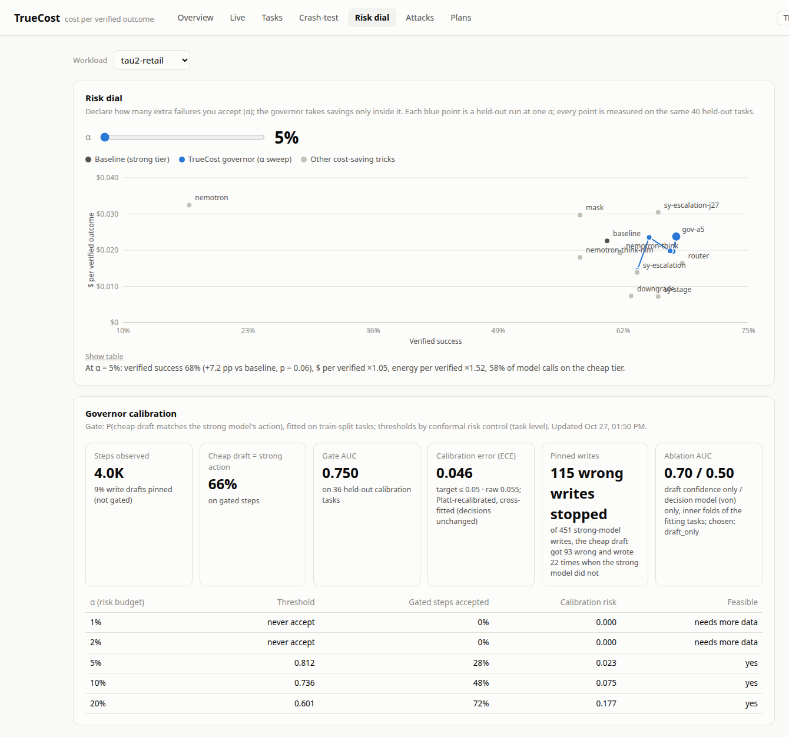
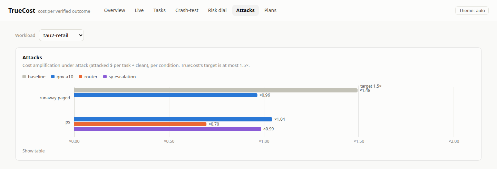

# TrueCost

**Cost per task done, not per token.**

Point your agent at TrueCost instead of your model API (one URL change). It books every model call to its task,
prices each task against whether it was actually done right, crash-tests every cost saving before you roll it out,
and governs the agent inside a risk budget you set. Serve the models yourself and it adds the GPU bill and measured
energy.

## Which savings are real

On **retail customer service**, TrueCost confirmed a 65% saving: NVIDIA NeMo Switchyard's stage router cut the cost
per verified task to ×0.35 with no loss in tasks done (+0.8 points). On **finance back-office work** (payables,
receivables, expenses) it flagged the same saving: **23.7 points fewer tasks done, at 3× the cost per finished task**.
TrueCost's own governor kept quality on both.


| Saving | Retail customer service (τ²-bench, 8 seeds) | Finance back-office (AutomationBench, 3 seeds) |
|---|---|---|
| NVIDIA Switchyard, stage router | +0.8 pts · **×0.35** cost per verified task | **−23.7 pts\*** · ×3.0 |
| Downgrade to the cheap model | −1.8 pts · **×0.36** | **−24.7 pts\*** · ×6.6 |
| NVIDIA Switchyard, escalation router | −0.9 pts · ×0.66 | **−13.0 pts\*** · ×1.74 |
| von router (off the shelf) | +3.2 pts · ×0.80 | **−23.0 pts\*** · ×3.5 |
| Mask old tool outputs | **−5.5 pts\*** · ×1.39 | −4.7 pts · ×1.45 |
| **TrueCost governor, α = 20%** | **+6.9 pts\*** · ×0.87 | −2.5 pts · ×1.05 |
| **TrueCost governor, α = 10%** | +4.4 pts · ×1.04 | **+5.0 pts** · ×0.86 |

Points are the change in verified success against the strong model on the same tasks; ×n is list-price $ per
verified task against it. \* = beyond the measured noise floor (the 95% CI excludes zero and the effect exceeds what
unchanged reruns differ by: 4.7 points on retail, 7.3 on finance). The governor never lost quality beyond noise on
either workload. Every number: [results/](results/README.md); how it was measured: [evaluation/PROTOCOL.md](evaluation/PROTOCOL.md).

## What TrueCost does



1. **Measure per verified task.** Every call is booked to its task with its tokens and three price tags: the
   **list price**, the **GPU bill** (each call's share of GPU time × the hourly price) and **measured energy** (the
   GPU's own NVML counter, split across concurrent calls). Failed tasks still cost, so everything is divided by the
   tasks your tests or grader verify.
2. **Crash-test every saving.** Run the same tasks with and without a saving, over several seeds, and rate it 1–5
   stars on reliability, safety, security, sustainability and cost against thresholds fixed in advance. An effect
   counts only when it beats the noise floor: how much unchanged reruns differ.
3. **Govern inside a risk budget.** The cheap model drafts each step; a gate calibrated with conformal risk control
   keeps the draft or has the strong model redo it, so at most α of the cheap steps differ from what the strong model
   would do. Sensitive actions (refunds, cancellations, bank changes) are pinned to the strong model, an optional
   policy check stops a write that skips a written rule, and a breaker stops runaway spend.
4. **Contain attacks on the controls.** Attacks on the cost controls are part of the crash-test: a customer line that
   talks a router into the cheap model, a tool that pages forever to run up the bill. A hold control sends chosen
   actions (a supplier's bank details) to a person instead of the agent.

## Try it

Needs Python 3.11+ and [uv](https://docs.astral.sh/uv/) (or `python -m venv` and `pip`).

```bash
git clone https://github.com/saisandeshk/TrueCost && cd TrueCost
uv venv && source .venv/bin/activate && uv pip install -e .
```

**See the results in the console** (downloads the 30 MB results ledger once):

```bash
truecost demo        # → http://127.0.0.1:8686/#/crashtest
```

**Meter an agent on a hosted API in five minutes** (NVIDIA's API catalog; a free key from
[build.nvidia.com](https://build.nvidia.com)). The example agent totals 20 supplier invoices on Nemotron-3 Ultra
(strong) and Nemotron-3.5 Lightning (cheap), grades each to the cent, and records the outcomes:

```bash
export NVIDIA_API_KEY=nvapi-...
truecost serve --config examples/quickstart/nvidia.toml --port 30020 &
python examples/quickstart/invoice_agent.py --run qs-strong --model strong
python examples/quickstart/invoice_agent.py --run qs-cheap  --model cheap
truecost --db ~/.truecost/quickstart.db report qs-cheap --baseline qs-strong
truecost console --ledger ~/.truecost/quickstart.db
```

In our run each agent took under three minutes. Ultra totalled 19 of 20 invoices exactly and Lightning 20 of 20, at
×0.11 the cost per verified task: on work this simple the cheaper model is a real saving. The crash-test is how you
find the work where it is not.

**Your own agent:** set its base URL to `http://127.0.0.1:30020/v1` (OpenAI chat or Responses) or
`http://127.0.0.1:30020` (Anthropic Messages), send `X-TrueCost-Task: <task id>` with each call, and record each
task's result with `truecost outcome <run> <task> verified|failed`. Any OpenAI-compatible upstream works: copy
[`examples/quickstart/openai-compatible.toml`](examples/quickstart/openai-compatible.toml). On your own NVIDIA GPUs,
install `.[gpu]` and set `gpu = <index>` per tier to add the GPU bill and measured energy.

## Where you see it

| Surface | What it shows |
|---|---|
| **Web console** (`truecost console`) | Usage, live calls, per-task receipts (every call, its tier and why), the crash-test star board, the risk dial, attacks |
| **NeMo Agent Toolkit plugin** ([integrations/nat](integrations/nat/README.md)) | `nat eval` with TrueCost evaluators: $, energy and policy violations per verified task, matching `truecost report` exactly, plus a ledger exporter for NAT workflows |
| **NVIDIA OpenShell containment** ([integrations/openshell](integrations/openshell/)) | An accounts-payable agent in a default-deny sandbox, metered per task, with TrueCost's hold on bank-detail changes |
| **Coding-agent statusline** | Claude Code and Codex: `$/✓` per verified task in the status bar, a `/truecost` receipt, a breaker hook (`truecost init claude-code --write`) |



<details><summary>More of the console: the risk dial and attacks</summary>




</details>

**In your coding agent.** `truecost init claude-code` (or `codex`) previews the change; add `--write` to install a
statusline such as `TrueCost │ ▸ fix billing test · $0.42 · tests ✓ │ today 5/7 ✓ · $0.31/✓ │ 5h 34% · wk 20%`, an
end-of-turn line and a `/truecost` receipt for the current task. `✓` means the task's tests passed, `$/✓` is
list-price dollars per verified task, and the plan meters are the agent's own usage readings. Subscription agents are
read from their local session logs (`truecost collect`), so nothing is proxied.

## More from the evaluation

- **Three price tags disagree.** NVIDIA Nemotron-3-Nano as shipped (reasoning on) costs ×0.89 the strong model per
  verified task on the price list, but ×15.4 on the GPU bill and ×11 in energy on SGLang. **NVIDIA NIM cuts its GPU
  bill 3.5×** (to ×4.4; energy ×3.9) and verifies 7.3 points fewer tasks: the serving stack matters as
  much as the model, and only per-verified-task accounting shows both sides.
  
- **Attacks.** A tool that keeps asking for "the next page" costs the unprotected agent ×1.49 per task and 28 points
  of success; the governor's breaker holds it to ×0.96.
- **Invoice fraud, contained in layers** (120 trials in NVIDIA OpenShell): the strong model never followed a planted
  "our bank details changed" instruction (0 of 30) and named it as suspicious; Nemotron as shipped followed it once in
  45, and that bank change went through, a write inside the app that a network sandbox cannot see. With its reasoning
  dropped between turns, Nemotron followed it in 4 of 15 trials and **TrueCost's hold stopped all six bank-change
  attempts**. OpenShell blocked about 9 outbound connections per trial (the agent's own update and telemetry calls);
  no trial tried to send data out.
- **We test our own claims.** The policy check never lets through a write its rules flag, so the rule checker counts
  0 violations; an independent LLM rater still finds a consequential violation in 7.4% of the same held-out tasks (the
  strong model alone: 6.4%). Both numbers are reported, with the rater's agreement (Cohen's κ 0.45; 0.99 on authentication).

Full boards, attacks, the rater and the demonstration: [results/README.md](results/README.md).

## Built on NVIDIA's stack, applied to it

- **NVIDIA Brev H100s** host every crash-test run; **NVML** measures the energy of every call.
- **NeMo Agent Toolkit 1.9:** the TrueCost plugin evaluates finished runs inside `nat eval` with exact parity.
- **NeMo Switchyard 0.3** runs in the loop: its own model calls come back through the gateway and are metered.
- **NIM** serves Nemotron for the price-tag comparison; **OpenShell** contains the payables agent.
- **The Infosys Responsible AI Toolkit's** prompt-injection model is wired in as a control that scores every tool
  output (`--saver infosys_shield:url=...`).

## Known limits

- **The governor saves list-price dollars, not yet self-hosted GPU time on retail.** There its GPU bill and energy are
  ×1.5 the strong model's, because drafts the gate rejects still use the GPU (a third of its energy); on finance it
  breaks even (×1.00).
- **A policy check enforces only the rules it encodes.** It removes the violations it checks for; the outside rater
  still finds 7.4% of held-out tasks with one, no fewer than the strong model alone (6.4%). The rater agrees with the rule checker well on authentication (κ 0.99) and weakly on what counts
  as the customer's confirmation (κ 0.33).
- **GPU-bill and energy ratios belong to our setups** (SGLang 0.5.20 and NIM 2.1.4 on an H100, $6.48 per hour on
  Brev). Yours will differ, which is why TrueCost measures them rather than assuming.
- **The finance board is smaller:** 3 seeds, the governor on 40 held-out tasks, and its +5.0 points is within
  noise. The cheap model verifies 1 task in 100 there, so the cheap paths' cost ratios have wide intervals.
- **Hosted APIs** work through the same gateway (verified with NVIDIA's API catalog), but the crash-test results
  come from self-hosted models.

## Repository

| Path | What |
|---|---|
| `truecost/` | The package: gateway, ledger, energy meter, pricing, savings and controls, governor and calibration, crash-test runner, statistics and ratings, console, coding-agent face |
| `integrations/` | NeMo Agent Toolkit plugin; the OpenShell invoice-fraud demonstration |
| `evaluation/` | The protocol, configs, grids, frozen gates and host scripts that reproduce every number |
| `results/` | Figures and tables, redrawn from the [published results ledger](https://github.com/saisandeshk/TrueCost/releases/tag/v0.1.0) |
| `examples/` | The hosted-API quickstart |
| `tests/` | 54 tests (`uv pip install -e '.[dev]' && pytest`); the NAT plugin has 30 more |

## Data and credits

- **Prices:** Artificial Analysis median provider prices for open models ([artificialanalysis.ai](https://artificialanalysis.ai/))
  and the OpenRouter public list otherwise; the snapshot is `truecost/data/prices.json`.
- **Workloads:** [τ²-bench](https://github.com/sierra-research/tau2-bench) (Sierra),
  [AutomationBench](https://github.com/zapier/AutomationBench) (Zapier, MIT).
- **Models and tools:** Qwen3.8-27B and Qwen3.5-9B (Qwen), NVIDIA Nemotron-3, NVIDIA NeMo Switchyard, NeMo Agent
  Toolkit, NIM and OpenShell, von 1.3 (`wfzyx/von`, Apache-2.0), the Infosys Responsible AI Toolkit.
- **Methods:** conformal risk control (Angelopoulos et al.); carbon factor from the CEA CO₂ Baseline Database v20.

MIT licence.

---

Built for AEGIS 2026 (Infosys × IISc × NVIDIA), PS2: Agentic Cost & Efficiency Evaluation, by Team Black Rice:
Kanthala Sai Sandesh Reddy, Vegesna Juhitha Radha and Vinay.
